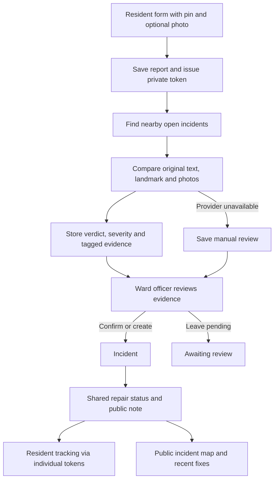

# LeakLedger

Two residents describe the same broken pipe in different languages. A third describes a leak just down the street. LeakLedger helps a ward officer compare their evidence and decide how many repairs to dispatch. The project is a one-ward demonstration for IDEA//FORGE Track 1, Problem 2.

| Entry point | What to try |
| --- | --- |
| `/report` | Submit in Hindi or English, select a map pin or demo landmark, and optionally attach a JPEG, PNG or WebP photo. Save the private tracking link. |
| `/` | Sign in as the ward officer. Compare original accounts, photos and source-tagged evidence, confirm a link or create a separate incident, then post a repair note. |
| `/track/<token>` | Read this report’s repair status and latest public note. Each resident receives a separate unguessable link. |
| `/dashboard` | Explore open and repaired incident counts, mapped incidents and recent fixes. Resident reports and attachments remain private. |

## Run locally

Use Node.js **24.x** and npm. From the repository root, run:

```bash
npm ci
cp .env.example .env.local
npm run dev
```

Open `http://localhost:3000`. With the example environment left blank, the app creates a seeded SQLite database, runs a deterministic comparison and allows officer sign-in with `ward-demo`. Each resident and officer browser uses the same server-side database. Production builds require the officer credentials below. To start a fresh rehearsal while preserving an earlier local run, set `LEAKLEDGER_DATA_DIR` to a new empty directory before starting the server.

## Configure Supabase and live analysis

Create a new Supabase project with Postgres, Auth and Storage available. Copy its project URL and legacy service-role JWT from the project settings into `.env.local`. The migration creates the tables, restricted RPC functions, RLS settings and private storage bucket. Use the database connection string from the Supabase Connect dialog to run the migration and seed on the **new, clean project**. Enter the connection string, including its database password, at the Bash prompt:

```bash
read -rsp 'Supabase Postgres connection URL: ' SUPABASE_DB_URL
echo
export SUPABASE_DB_URL
psql "$SUPABASE_DB_URL" -v ON_ERROR_STOP=1 -f supabase/migrations/202611210001_ward.sql
psql "$SUPABASE_DB_URL" -v ON_ERROR_STOP=1 -f supabase/seed.sql
unset SUPABASE_DB_URL
```

The seed creates LL-1041 (tea stall), LL-1042 (school gate) and LL-1043 (pending Hindi report). Rerunning the seed preserves existing decisions. Tracking tokens are generated for that database. Sign in as the officer to open the tracking links for linked reports.

| Server environment variable | Purpose |
| --- | --- |
| `SUPABASE_URL`, `SUPABASE_SERVICE_ROLE_KEY` | Set both for shared Postgres records and private Storage. Leave both blank for local SQLite. |
| `OFFICER_PASSWORD` | Password for the single officer account. Set a private value when using Supabase or a production build. |
| `OFFICER_SESSION_SECRET` | Signing key for the HttpOnly officer session cookie. Generate a value with `openssl rand -hex 32`. |
| `OPENAI_API_KEY` | Enables live server-side vision comparisons of submitted text, landmarks and supplied images. Without a key, Supabase mode records an unavailable comparison for manual review. |
| `OPENAI_MODEL` | Vision-capable chat completions model supporting JSON output. Default `gpt-4o-mini`. |
| `CANDIDATE_RADIUS_M` | Maximum distance for candidate search in metres. Default `150`. |
| `LEAKLEDGER_DATA_DIR` | Optional directory for local SQLite reports and images. Defaults to a directory under the system temporary directory. |

Restart the server after changing its environment. Keys belong in the server environment. The browser communicates with same-origin API routes.

## How a report becomes a repair



The report keeps the resident’s original submission. The incident represents the physical repair. Distance limits the comparison set. The model compares evidence from one representative report per candidate and tags each detail as resident text, photo or landmark. Invalid model output gets one retry. An officer makes the linking decision, and each report can link to one incident. A public note is stored once against that incident and appears on every linked tracking page.

## Tests, build and evaluation

```bash
npm test
npm run build
npm start
```

Stop the local server, then run the browser check. Playwright starts its own development server on port 3219, signs in, submits a photo from a mobile-sized browser, checks both tracking links and visits the public dashboard. Its screenshot is saved under `test-results/`. The verified run is shown in [the officer comparison screenshot](docs/officer-comparison.png).

```bash
npx playwright install chromium
npm run test:e2e
```

For a machine with system Chromium already installed, use `PLAYWRIGHT_CHROMIUM_EXECUTABLE=/usr/bin/chromium npm run test:e2e` instead of installing another browser.

```bash
npm run eval
```

The evaluation uses the eight heldout pairs from `eval/pairs.json`. Four development pairs are excluded from the reported counts. With an API key it runs the live comparison and writes per-pair verdicts, errors and counts to `eval/results.json`. Without a key it records the live run as blocked. The deterministic mock has its own results section. All twelve evaluation pairs are staged and text-only.

## Deploy to Vercel

Use the Supabase migration and seed above first. In the repository root, link a Vercel project using the Next.js preset, repository root as the project directory, Node.js 24.x and the default Next.js build settings. Enter the values from your own configuration at the environment prompts:

```bash
npx vercel@latest login
npx vercel@latest link
npx vercel@latest env add SUPABASE_URL production
npx vercel@latest env add SUPABASE_SERVICE_ROLE_KEY production
npx vercel@latest env add OFFICER_PASSWORD production
npx vercel@latest env add OFFICER_SESSION_SECRET production
npx vercel@latest env add OPENAI_API_KEY production
npx vercel@latest deploy --prod
```

To customize the model or radius, use `npx vercel@latest env add OPENAI_MODEL production` or `npx vercel@latest env add CANDIDATE_RADIUS_M production` before deployment. Visit the URL printed by Vercel, submit a new report at `/report` and run the walkthrough in [DEMO.md](DEMO.md). Use Supabase for hosted demos. A serverless instance’s temporary filesystem does not provide durable cross-instance storage.

## Limitations

- The ward, seed reports, sample photos and baseline comparisons are staged. The two bundled school-gate photos are AI-generated illustrations for the demo. The offline model uses a limited bilingual vocabulary and does not interpret photos. A fresh submission with a configured provider exercises live vision.
- Routing labels identify a simulated department. The prototype has no live municipal dispatch integration, audio intake or video intake.
- An officer reviews severity and identity evidence before linking. Similar landmarks and close coordinates can occur at separate leaks. The evaluation covers eight heldout text comparisons and does not measure field accuracy or photo recognition.
- A tracking URL is a bearer secret. It shows repair status and the latest public note. The dashboard publishes the officer’s public notes, so use descriptions of the repair without personal details.
